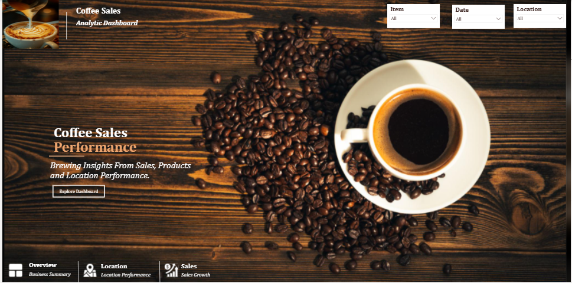
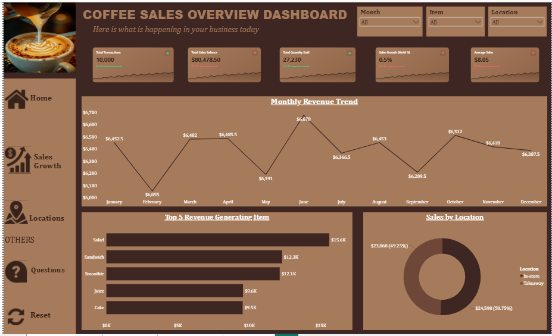

# ☕ Coffee Shop Sales Analysis Dashboard

## 📌 Project Overview

The **Coffee Shop Sales Analysis** project is an interactive business intelligence solution developed using **Power BI** to analyze coffee shop sales performance, product trends, and location-based revenue.

The project focuses on transforming raw sales data into meaningful business insights through data cleaning, transformation, DAX calculations, and interactive visualizations.

The dashboard enables users to monitor key performance indicators, identify top-performing products, track monthly revenue trends, and evaluate sales distribution across different locations and sales channels.

## 🎯 Project Objectives

The primary objectives of this project are to:

- Analyze overall coffee shop sales performance.
- Monitor key business performance indicators (KPIs).
- Identify top revenue-generating products.
- Track monthly revenue trends and sales growth.
- Evaluate sales performance across different locations.
- Compare sales performance across transaction channels.
- Provide actionable insights to support data-driven business decisions.

## 🛠️ Tools & Technologies

| Tool | Purpose |
|---|---|
| Power Query | Data cleaning and transformation |
| Power BI | Data modeling and visualization |
| DAX | Measures, KPI calculations, and time-based analysis |
| GitHub | Project documentation and version control |

## 📊 Dashboard Structure

The dashboard consists of four interactive sections:

### 1. Landing Page

The landing page serves as the dashboard's entry point, featuring a coffee-themed design and navigation buttons that provide access to the different analytical sections.

### 2. Sales Overview Dashboard

Provides a summary of the coffee shop's overall business performance.

**Key Performance Indicators (KPIs):**
- Total Transactions
- Total Sales Balance
- Total Quantity Sold
- Sales Growth (Month-over-Month)
- Average Sale

**Visualizations:**

- **Monthly Revenue Trend:** Tracks revenue performance across the twelve months of the year.
- **Top 5 Revenue-Generating Items:** Highlights the products contributing the highest revenue.
- **Sales by Location:** Illustrates the distribution of sales across In-store and Takeaway channels.

**Interactive Filters:**
- Month
- Item
- Location

### 3. Sales Analysis

This section focuses on understanding sales performance and identifying trends in product sales and revenue generation.

It provides insights into:
- Sales performance over time.
- Monthly sales comparisons.
- Revenue changes and growth patterns.
- Product sales performance.
- Quantity sold and average sales.

### 4. Location Analysis

This section examines sales performance across different business locations.

It focuses on:
- Top-performing sales locations.
- Lowest-performing sales locations.
- Location revenue contribution.
- Sales and transaction comparisons by location.
- Average sales across locations.
- Location ranking over time.

These insights help identify high-performing locations and areas that may require improvement.

## 📈 Key Business Metrics

The dashboard tracks the following metrics:

| Metric | Description |
|---|---|
| Total Sales | Overall revenue generated |
| Total Transactions | Total number of sales transactions |
| Total Quantity Sold | Total units of products sold |
| Average Sale | Average sales value per transaction |
| Sales Growth % | Percentage change in sales compared with the previous month |
| Revenue Contribution % | Percentage of total revenue generated by a location or category |

## 💡 Business Questions Addressed

This analysis helps answer important business questions, including:

1. What is the overall sales performance of the coffee shop?
2. How does revenue change from month to month?
3. Which products generate the highest revenue?
4. Which products contribute the least to sales?
5. How is sales performance changing over time?
6. Which locations generate the highest revenue?
7. Which locations have the lowest sales performance?
8. What percentage of revenue does each location contribute?
9. How do transaction volumes compare across locations?
10. How does average sales value vary across locations?

## 🔍 Interactive Features

The dashboard incorporates interactive features to improve data exploration:

- Dynamic slicers for filtering by month, item, and location.
- Interactive navigation between dashboard pages.
- KPI cards displaying key business metrics.
- Comparative sales analysis.
- Time-based performance tracking.
- Reset functionality for clearing applied filters.

## 📌 Project Insights

The dashboard provides a consolidated view of business performance, making it easier to:

- Identify products generating the highest revenue.
- Monitor monthly revenue fluctuations.
- Evaluate the balance between In-store and Takeaway sales.
- Compare performance across business locations.
- Track changes in sales performance over time.
- Identify opportunities for improving revenue and operational performance.

## 🖥️ Dashboard Preview

### Landing Page

### Sales Overview

## 🚀 Live Dashboard

Explore the interactive Power BI dashboard:

[**View Coffee Shop Sales Dashboard →**](https://app.powerbi.com/view?r=eyJrIjoiOWZiMjA3YWQtMmYyOC00YWM2LTgwZTUtOGQ1ZDYxNDVlYzk2IiwidCI6IjQ4NTkyZTczLTE2OTUtNGVmMy1hYzg3LWM0ZDNjMGVhNDYzMyJ9)

## 📂 Project Repository

[**View Project Files on GitHub →**](https://github.com/Horpeyhemi/COFFEE-)

## 📝 Conclusion

The Coffee Shop Sales Analysis project demonstrates how data cleaning, transformation, DAX calculations, and interactive Power BI visualizations can be combined to create a comprehensive business intelligence dashboard.

By bringing together sales, product, and location analysis, the dashboard provides a clearer understanding of business performance and supports informed, data-driven decision-making.

---

Project Category: Data Analytics | Business Intelligence

Tools: Power Query | Power BI | DAX

Author: Rahman Azeezat Taiwo
